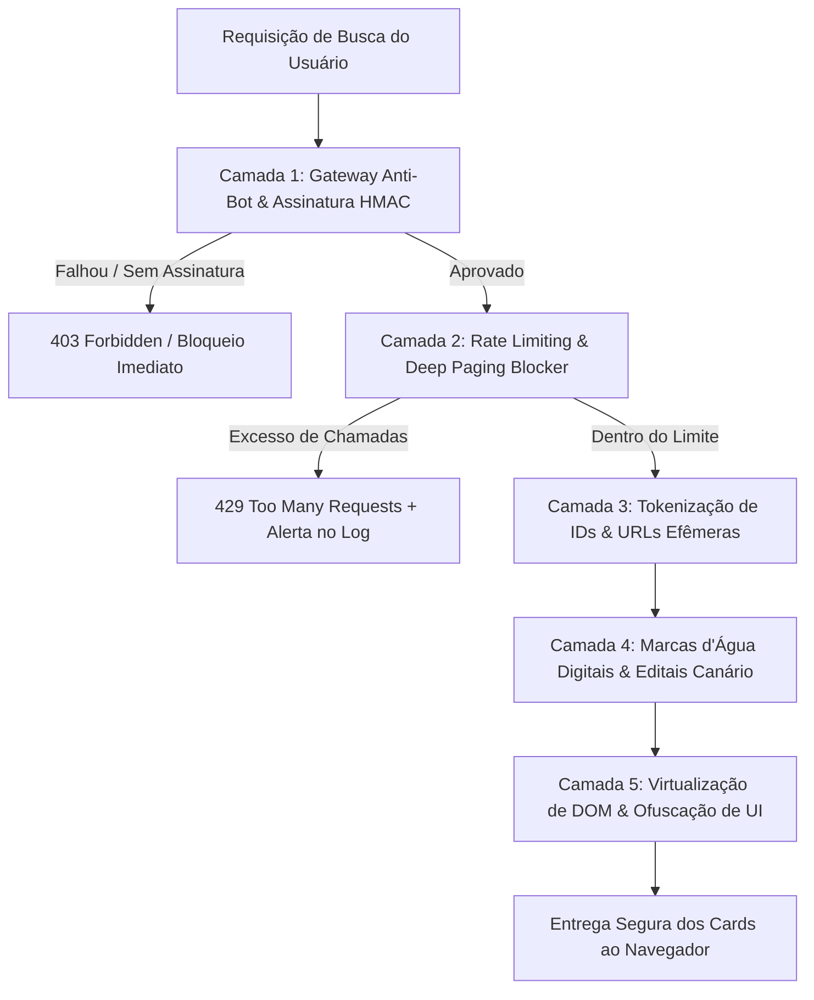

# Diretrizes Técnicas e Jurídicas: Proteção Anti-Scraping e Defesa Contra Espelhamento do Buscador de Editais

> **Status:** Aprovado para arquitetura  
> **Módulo:** LattesData Fomento (Buscador Inteligente de Editais)  
> **Objetivo:** Blindar o banco de dados enriquecido de editais contra extração em massa (data harvesting), cópia não autorizada, engenharia reversa e espelhamento por terceiros ou plataformas concorrentes.

---

## 1. Contexto e Tese de Valor Proprietário

O dado primário de uma chamada pública (o edital publicado no Diário Oficial ou no site da FAP) é público por natureza. No entanto, o **dado processado pelo LattesData é uma criação proprietária e protegida**, pois incorpora:

1. **Esforço de Coleta Contínua:** Robôs de raspagem mantidos e calibrados para 10 portais com estruturas instáveis.
2. **Normalização & Enriquecimento Semântico:** Classificação por teto orçamentário real, identificação de rubricas permitidas (custeio vs. capital), exigência de contrapartida e rastreamento de cotas de bolsas (IC, Mestrado, Doutorado).
3. **Mapeamento de Compliance Científico (Packs LattesData):** Detecção automática de exigências de *SisGen*, *CEUA*, *CEP/CONEP*, *TRL* e *Gate de Patente INPI*.
4. **Algoritmo de Recomendação (Match Score):** Cruzamento comportamental com a produção dos últimos anos do currículo Lattes do pesquisador.

> [!IMPORTANT]
> A extração automatizada da nossa base pronta e estruturada configura **enriquecimento sem causa, concorrência desleal e violação de direitos autorais sobre compilação de banco de dados** (Lei nº 9.610/98, Art. 7º, XIII) e dos Termos de Uso (Marco Civil da Internet, Lei nº 12.965/14).

---

## 2. Arquitetura de Defesa em 5 Camadas Técnicas

Para impedir tanto scrapers simples (scripts Python/cURL) quanto scrapers sofisticados (navegadores automatizados via Puppeteer/Playwright), implementamos a seguinte matriz de proteção:

---

### Camada 1: Gateway Anti-Bot & Assinatura Dinâmica (HMAC)
*Objetivo: Garantir que a requisição venha exclusivamente do front-end oficial aberto por um ser humano.*

1. **Assinatura de Requisição em Tempo Real (Request Signing):**
   * Toda chamada para o endpoint `/api/v1/editais/search` deve carregar três cabeçalhos obrigatórios:
     * `X-Timestamp`: Hora atual em UTC (com tolerância máxima de 30 segundos).
     * `X-Nonce`: String aleatória única descartável (usada apenas uma vez).
     * `X-Signature`: Hash `HMAC-SHA256(timestamp + nonce + payload + secret_efemero)`.
   * Scripts que façam requisições diretas via cURL ou bibliotecas simples não possuem a rotina JS do front-end e são rejeitados de imediato com `403 Forbidden`.
2. **Validação de Cabeçalhos Client-Hints & Browser Fingerprint:**
   * Verificação obrigatória dos cabeçalhos modernos do navegador: `Sec-Fetch-Site: same-origin`, `Sec-Fetch-Mode: cors`, `Sec-CH-UA`.
   * Rejeição automática de requisições com cabeçalhos padrão de ferramentas de automação ou User-Agents desatualizados.
3. **Autenticação com JWT de Curta Duração:**
   * Acesso à busca restrito a sessões ativas (orientador ou discente logado). O token expira a cada 15 minutos e é renovado em background via cookie `HttpOnly` com flag `SameSite=Strict`.

---

### Camada 2: Rate Limiting Inteligente & Bloqueio de Paginação Profunda
*Objetivo: Impedir que robôs varram o catálogo completo em poucos minutos.*

1. **Taxa de Chamadas Restrita (Token Bucket):**
   * Limite de **15 consultas por minuto** por usuário autenticado / IP.
   * Tolerância para até 25 requisições em rajada rápida (*burst*), com cooldown automático de 60 segundos.
   * Detecção de padrão robótico: intervalos perfeitamente regulares (ex.: exatamente 1 requisição a cada 2,0 segundos) acionam desafio invisível (Proof-of-Work local via WebWorker).
2. **Bloqueio de Paginação Profunda (Deep Paging Blocker):**
   * Um usuário humano legítimo visualiza as 3 primeiras páginas e, se não encontrar o que deseja, refina os filtros.
   * Um scraper quer iterar até o final: `page=1, 2, 3, ... 200`.
   * **Regra de Defesa:** O endpoint limita os resultados a no máximo **50 itens por busca (offset máximo de 50)**. Para acessar outros editais, o usuário deve obrigatoriamente usar os filtros de agência, área ou valor.

---

### Camada 3: Tokenização de IDs & URLs de Download Efêmeras
*Objetivo: Evitar que um terceiro descubra IDs sequenciais ou baixe todos os PDFs do nosso armazenamento.*

1. **IDs Públicos Criptografados (Hashids / UUIDv4 Salteado):**
   * A API **nunca** retorna IDs sequenciais do banco relacional (`id: 1, 2, 3`).
   * Retorna um identificador ofuscado e salteado com chave do dia: `edital_ref: "k8x9-b2m1-99af"`.
   * Um invasor não consegue escrever um loop `for i in range(1, 10000)` para baixar a base inteira.
2. **Proxy de Download com Link de Uso Único:**
   * O botão "Baixar PDF" não expõe o link direto do servidor governamental nem o caminho do nosso bucket S3.
   * O clique chama `/api/v1/edital/download-ticket`, que gera uma URL assinada temporária válida por **60 segundos**, atrelada exclusivamente ao IP e à sessão daquele usuário.

---

### Camada 4: Marcas d'Água Invisíveis & Registros "Canário" (Rastreabilidade Forense)
*Objetivo: Provar judicialmente a cópia em caso de vazamento ou espelhamento por concorrentes.*

1. **Registros Canário (Honeypot Grants):**
   * Inserção controlada na base de dados de uma quantidade mínima de "editais canário" fictícios ou históricos com sutis discrepâncias intencionais (ex.: chamada de apoio institucional com código específico de controle interno do LattesData).
   * Se um concorrente espelhar nossa base, esse edital canário aparecerá na plataforma dele, configurando **prova pericial irrefutável de extração do nosso banco**.
2. **Marcas d'Água em Texto Invisível (Zero-Width Steganography):**
   * Nos campos de `resumo` e `metadados` tratados pela nossa inteligência, injetamos sequências imperceptíveis de caracteres Unicode invisíveis (*Zero-Width Space* `U+200B`, *Zero-Width Non-Joiner* `U+200C`).
   * Essa sequência codifica o ID interno do LattesData e o timestamp.
   * Se o concorrente raspar o texto e exibir em outro site, a marca d'água oculta permanece no texto copiado e pode ser revelada em auditoria pericial.

---

### Camada 5: Proteção de Front-end (Virtualização & Anti-Headless)
*Objetivo: Impedir que extensões ou scripts de navegador automatizado capturem o HTML renderizado.*

1. **Virtualização de Lista:**
   * O catálogo não renderiza todos os cards no código HTML de uma vez. Utiliza renderização virtual: apenas os 4 ou 5 cards que cabem na tela visível do usuário existem no DOM. Conforme o usuário rola a página, os elementos fora do viewport são destruídos.
   * Extensões simples que leem o documento inteiro recebem apenas fragmentos.
2. **Bloqueio de Automação Headless:**
   * Detecção no front-end de variáveis globais típicas de ambientes automatizados (`navigator.webdriver === true`, ausência de plugins, dimensões anômalas de tela). Se detectado, a interface limita os resultados ou exibe dados deliberadamente truncados.

---

## 3. Matriz de Resposta a Incidentes (Trilha de Ação)

| Nível de Suspeita | Comportamento Detectado | Ação Automática do Sistema |
| :--- | :--- | :--- |
| **Nível 1 · Moderado** | Mais de 20 buscas/minuto ou alternância rápida de filtros | Resposta `429 Too Many Requests` com bloqueio temporário de 15 minutos para o IP. |
| **Nível 2 · Alto** | Paginação sequencial rápida tentando contornar limites ou User-Agent de bot | Invalidação imediata do token JWT da sessão e exigência de reautenticação com desafio interativo. |
| **Nível 3 · Crítico** | Múltiplas contas/IPs varrendo o catálogo em padrão distribuído | Bloqueio das contas envolvidas, congelamento de sessão e notificação imediata à equipe de segurança no dashboard de logs. |

---

## 4. Fundamentação Jurídica & Termos de Uso (Termos de Serviço)

Para garantir respaldo legal no Brasil (sob o Marco Civil da Internet e a Lei de Direitos Autorais), o módulo de fomento é respaldado pelas seguintes cláusulas contratuais:

1. **Cláusula de Uso Estritamente Pessoal e Acadêmico:**
   * A licença de uso do LattesData Fomento é concedida exclusivamente ao pesquisador e sua equipe para fins de pesquisa e captação de recursos próprios.
2. **Vedação Expressa de Raspagem de Dados e Espelhamento:**
   * É terminantemente proibido o uso de robôs, spiders, scripts automatizados, scrapers ou qualquer tecnologia destinada a coletar, indexar, copiar ou republicar o catálogo de editais, seus resumos, tags de compliance ou notas de compatibilidade.
3. **Auditoria e Logs Imutáveis:**
   * Toda consulta ao buscador gera registro contendo: ID do usuário, endereço IP de origem, timestamp com precisão de milissegundos e parâmetros da pesquisa. Esses logs são assinados digitalmente e armazenados por 12 meses para fins de cumprimento do Art. 15 da Lei nº 12.965/14 (Marco Civil).
4. **Notificação Extrajudicial Imediata (Takedown Notice):**
   * Identificado o espelhamento de dados (comprovado pela presença de marcas d'água ou registros canário), aciona-se notificação extrajudicial com prazo de 24 horas para retirada do ar, sob pena de ação judicial de obrigação de não fazer cumulada com perdas e danos e tutela de urgência.

---

## 5. Resumo Executivo para Apresentação a Stakeholders

> **Como garantimos que nosso esforço de rastreamento não será roubado?**  
> *"Nenhum terceiro conseguirá replicar o buscador do LattesData porque nossa base não é exposta crua. As requisições exigem assinatura criptográfica dinâmica, o volume de consultas é rigorosamente limitado por usuário, os IDs são efêmeros e todo o texto tratado carrega esteganografia forense e registros canário. Quem tentar raspar nossos editais enfrentará bloqueios automatizados em camadas e, se conseguir qualquer fragmento, deixará prova jurídica incontestável para derrubada imediata da cópia."*
