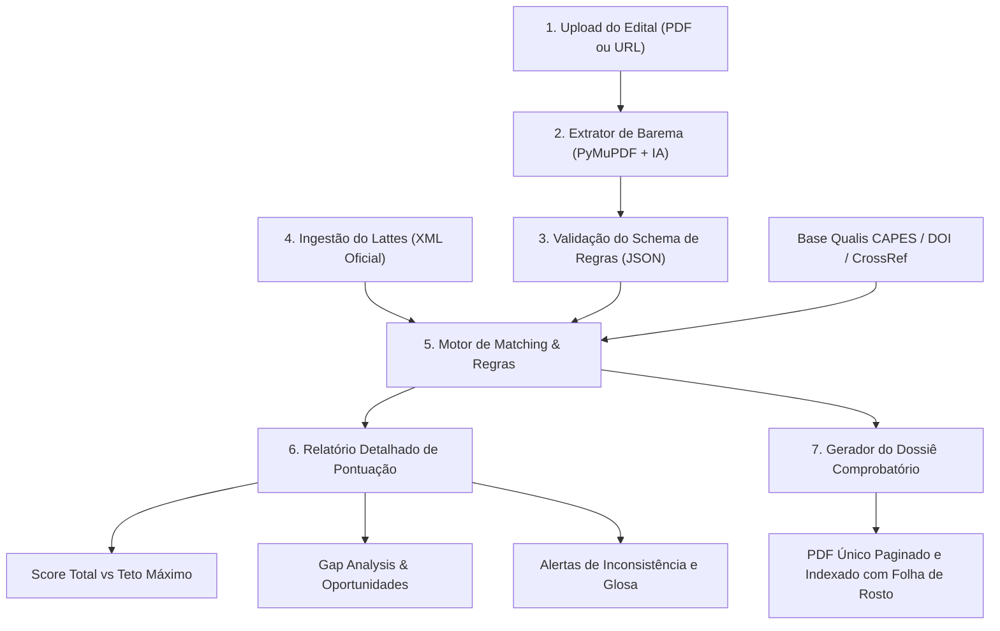

# Especificação Técnica: Módulo de Cálculo de Pontuação de Editais e Baremas (EditalScore)

## 1. Visão Geral e Proposta de Valor

O **EditalScore (Calculadora Automática de Baremas & Dossiê de Títulos)** é um módulo avançado do **LattesFácil** concebido para eliminar uma das maiores dores de pesquisadores, docentes e candidatos a pós-graduação ou concursos públicos no Brasil: **o cálculo manual de pontos da prova de títulos e a montagem do caderno de comprovação**.

Atualmente, candidatos a seleções como:
* Concursos para Professor Efetivo (Universidades Federais/Estaduais e Institutos Federais - EBTT);
* Editais de Mestrado e Doutorado (PPGs CAPES);
* Residências Médicas (ex: ENARE, USP, UNIFESP);
* Editais de Bolsas e Auxílios de Fomento (CNPq, CAPES, FAPESP, FAPERJ, etc.);

enfrentam tabelas de baremas complexas, com dezenas de itens pontuáveis, subtetos rígidos, janelas temporais restritas (ex: "últimos 5 anos") e exigência de compilação de comprovantes em ordem estrita. O erro na contagem manual frequentemente gera recursos administrativos indeferidos e perda de aprovação.

O LattesFácil resolve isso ao cruzar diretamente o **Edital em PDF** com o **Currículo Lattes (XML)** e os **documentos comprobatórios digitalizados**.

---

## 2. Fluxo de Execução Ponta a Ponta



---

## 3. Arquitetura do Módulo

O sistema é dividido em quatro componentes fundamentais:

### 3.1. Extrator e Parser de Editais (`barema_parser.py`)
* **Entrada**: PDF do edital do processo seletivo ou recorte das páginas do Anexo/Barema.
* **Técnica de Extração**:
  * Segmentação e extração de tabelas com `pdfplumber` / `PyMuPDF` (`fitz`).
  * Processamento de linguagem natural (LLM estruturado com prompt estrito de schema JSON) para normalizar descrições textuais variadas em chaves padronizadas do Lattes.
* **Saída Padronizada (`barema_schema.json`)**:
  ```json
  {
    "edital_id": "UFRJ-2026-PROF-TITULAR",
    "titulo": "Concurso Público Professor Magistério Superior - UFRJ 2026",
    "janela_temporal_anos": 5,
    "teto_geral_pontos": 100.0,
    "blocos": [
      {
        "nome": "Bloco I - Produção Bibliográfica",
        "teto_bloco": 40.0,
        "itens": [
          {
            "id": "1.1",
            "descricao": "Artigo em periódico Qualis A1 ou A2",
            "tipo_lattes": "ARTIGO-PUBLICADO",
            "criterio_filtro": {"qualis": ["A1", "A2"]},
            "pontos_unitarios": 10.0,
            "teto_item": 30.0,
            "periodo_restrito": true
          },
          {
            "id": "1.2",
            "descricao": "Livro autoral com conselho editorial e ISBN",
            "tipo_lattes": "LIVRO-PUBLICADO",
            "criterio_filtro": {"tipo": "LIVRO"},
            "pontos_unitarios": 8.0,
            "teto_item": 16.0,
            "periodo_restrito": true
          }
        ]
      },
      {
        "nome": "Bloco II - Atividade Didática e Docente",
        "teto_bloco": 30.0,
        "itens": [
          {
            "id": "2.1",
            "descricao": "Semestre de docência no Ensino Superior",
            "tipo_lattes": "ATUACAO-PROFISSIONAL",
            "criterio_filtro": {"tipo_vinculo": "DOCENCIA_SUPERIOR"},
            "pontos_unitarios": 2.5,
            "teto_item": 25.0,
            "periodo_restrito": false
          }
        ]
      }
    ]
  }
  ```

### 3.2. Motor de Cruzamento e Matching (`edital_matcher.py`)
* Realiza o parser no XML exportado do Lattes (`curriculo.xml`).
* Aplica os filtros:
  * **Janela Temporal**: descarta produções fora do período estipulado pelo edital (ex: considerar apenas produções a partir de 2021).
  * **Verificação Qualis-CAPES**: consulta a base Qualis local/API do ISSN para classificar artigos automaticamente entre A1 e B4.
  * **Cálculo de Teto Unitário vs. Teto de Bloco**: garante que produções excedentes não inflem a nota de forma errônea (evitando a frustração comum de candidatos desclassificados pela banca).
* Classifica cada item do Lattes em um dos 4 estados:
  1. `PONTUOU_COMPLETO`: Item atende aos critérios, está dentro do teto e tem comprovante indexado no LattesFácil.
  2. `PONTUOU_SEM_COMPROVANTE`: Item cadastrado no Lattes e válido, mas o usuário ainda não submeteu o PDF de comprovação.
  3. `EXCEDENTE_TETO`: Item válido, porém a pontuação máxima daquele subitem ou bloco já foi atingida.
  4. `DESQUALIFICADO`: Item fora da janela temporal ou que não atende a critério mínimo (ex: sem DOI/ISSN exigido).

### 3.3. Painel de Inteligência & Gap Analysis (UI / Analytics)
* **Score Card**: `Pontuação Estimada: 74,5 / 100 pontos` (com faixa de segurança contra glosas).
* **Simulador "What-If" e Recomendações Estratégicas**:
  * *"Seu bloco de Produção Bibliográfica atingiu o teto (40/40 pts). Não adianta enviar mais resumos ou artigos para este edital."*
  * *"Você tem 0 de 15 pontos no Bloco de Orientações. Você tem 3 TCCs concluídos no Lattes que não foram vinculados porque faltou anexar a ata de defesa."*
  * *"Se você comprovar mais 1 ano de experiência docente, sua nota sobe de 74,5 para 79,5 pontos."*

### 3.4. Compilador de Dossiê Comprobatório (`dossier_builder.py`)
* Em muitos concursos, a banca exige que os comprovantes sejam impressos ou anexados digitalmente em um único PDF sequencial numerado, rigorosamente na ordem do barema.
* O LattesFácil:
  1. Gera a **Folha de Rosto / Tabela de Autodeclaração** preenchida com a pontuação de cada item e o número da página onde está o comprovante.
  2. Concatena todos os PDFs de artigos, certificados e atas salvos localmente.
  3. Insere cabeçalho carimbado padronizado no topo de cada página: `[Item 1.1] Artigo em Periódico A1 - Página 14 de 98`.
  4. Exporta o `Dossie_Comprovatorio_Final.pdf` pronto para submissão à banca examinadora.

---

## 4. Diferenciais Competitivos

| Funcionalidade | Métodos Tradicionais / Consultorias | Outras Ferramentas | LattesFácil (EditalScore) |
| :--- | :--- | :--- | :--- |
| **Tempo de Análise** | 3 a 7 dias úteis | Não possuem esse recurso | **Menos de 30 segundos** |
| **Custo** | R$ 400 a R$ 800 por concurso | Assinaturas mensais sem a função | **Nativo / Local-First** |
| **Precisão** | Sujeito a erro humano de soma/leitura | Inexistente | **Determinístico com regras auditáveis** |
| **Geração de Dossiê** | Montagem manual no Word/PDF merger | Inexistente | **Geração automática de PDF paginado** |
| **Privacidade** | Requer envio de todos os dados pessoais | Nuvem proprietária | **100% no computador do usuário** |

---

## 5. Casos de Uso Reais Mapeados

1. **Concursos para Docentes em IFs e UFs**:
   * Baremas rígidos com pontuações decimais por hora-aula, orientações de PIBIC, bancas de defesa e artigos.
2. **Seleções de Pós-Graduação Stricto Sensu (Mestrado/Doutorado)**:
   * Pontuação focada em iniciação científica, monitoria, resumos em congressos e artigos iniciais.
3. **Residência Médica (Exame Nacional de Residência - ENARE)**:
   * Barema nacional unificado que pontua participação em ligas acadêmicas, estágios curriculares e publicações indexadas no PubMed/SciELO.
4. **Chamadas de Produtividade em Pesquisa do CNPq (PQ)**:
   * Avaliação do quinquênio ou decênio do pesquisador, calculando métricas de formação de recursos humanos e publicações de impacto.
